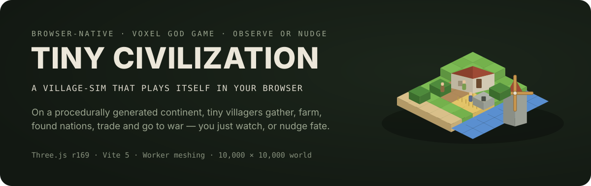
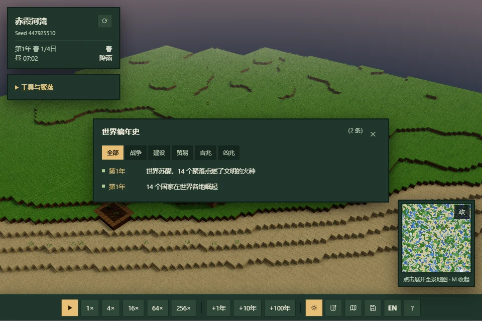
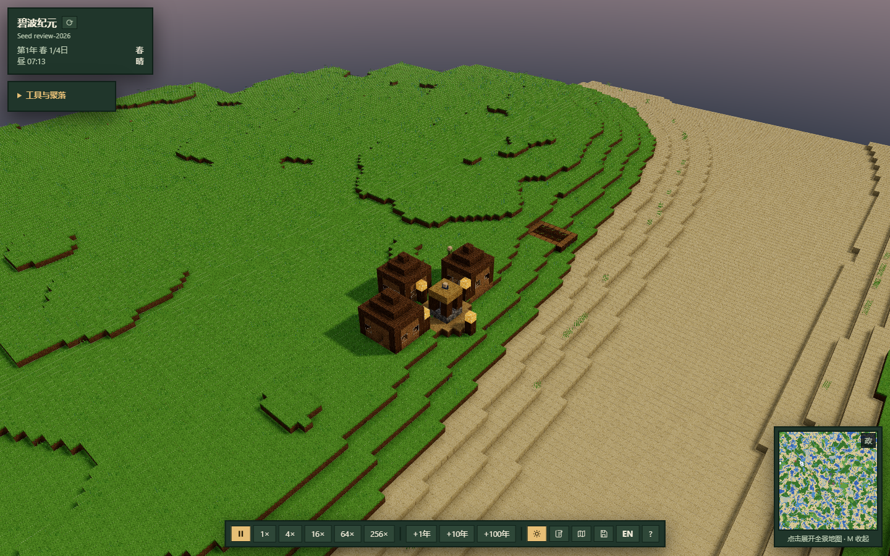
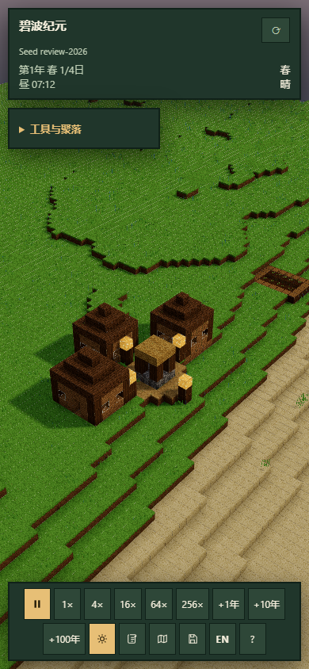

# Tiny Civilization

[简体中文](README.md) · **English** · [CI](https://github.com/LINYEANSHU/tiny-civilization/actions/workflows/ci.yml)



**Give the world a seed. Watch villages turn into history.**
Villagers gather, farm and build on a procedural voxel continent. Settlements form nations; trade and war enter the chronicle.
Watch quietly, or change the weather, plant a forest or found a settlement.

## Download for Windows

**[Download the portable Windows x64 build (ZIP)](https://github.com/LINYEANSHU/tiny-civilization/releases/download/windows-v1.0.0/tiny-civilization-windows-x64.zip)** · [Release notes](https://github.com/LINYEANSHU/tiny-civilization/releases/tag/windows-v1.0.0)

Extract the entire ZIP, open the `Tiny Civilization` folder, and double-click `Tiny Civilization.exe`. When the world is ready, you can watch the first settlement. Keep the folder together when moving the game.



<details>
<summary>View the browser layouts (desktop and narrow)</summary>





Captured during the November 6, 2026 desktop Chromium review with SwiftShader CPU WebGL rendering. Physical phone hardware was not tested.

</details>

## How the world develops

- **Seeded terrain.** The logical world spans 10,000 × 10,000 blocks and generates in chunks. A seed reproduces its initial terrain.
- **Settlements have needs.** Residents gather and farm; settlements expand around food, housing, storage and other demands.
- **Distance changes simulation detail.** Nearby villagers run individual behaviors; remote settlements use aggregate simulation over the same population and resource state.
- **The environment has consequences.** Seasons, weather, floods, wildfires and disease affect the evolving world.
- **History is traceable.** Nations, trade routes, wars and conquest appear on the full map and in a filterable chronicle.

There are no victory conditions or quests. Time controls and god tools let you compare long-term changes and return to ordinary observation anytime.

## Run the browser version from source

Requires Node.js 22+, npm and a modern desktop browser supporting WebGL 2.

```bash
git clone https://github.com/LINYEANSHU/tiny-civilization.git
cd tiny-civilization
npm ci
npm run dev
```

Open `http://127.0.0.1:8138` and wait for world generation.
Choose a settlement under “Tools & settlements”, or open the map to jump elsewhere.

```text
http://127.0.0.1:8138/?seed=my-world
```

The URL's `seed` sets the initial world. Generated seeds are written back to the URL so reloading can find the matching autosave.

```bash
npm run build       # output: dist/
npm run preview     # preview the production build
```

If Windows PowerShell blocks npm scripts, use `npm.cmd` for the same commands.

## Observe and intervene

| Action | Input |
| --- | --- |
| Pan / orbit / zoom | Left-drag or WASD / middle-drag / scroll |
| Inspect a resident or settlement | Click a villager, building or ground |
| Pause / change speed | `Space` / bottom 1×–256× buttons |
| Long-term evolution | +1, +10 and +100 year buttons |
| Full map / close panels | `M` / `Escape` |
| Chronicle / saves | Corresponding bottom buttons |
| Weather, disasters, food gifts | God tools under “Tools & settlements” |
| Performance details | `F3` |

Use sunlight lock during accelerated simulation to reduce day/night flicker. The language button switches Chinese and English.

## Save, export and restore

Select a settlement and open Civic Projects to put a granary or market first in its queue using the settlement's own materials.

IndexedDB autosaves every 3 minutes and when the page is hidden. It also provides 3 manual slots.
The bottom save panel supports saving, loading, deleting and JSON export/import.
Saves include the seed, clock, settlements, nations, voxel-edit journal, history and camera state.

Opening the game resumes the autosave, including the pause state and speed. If the URL specifies a seed, the autosave must match. Loading a manual slot resumes autosaving from that world.
A seed preserves the initial world. An evolved world also needs its save. The Windows app stores data in `%APPDATA%\Entertainment Desktop\tiny-civilization` by default.

## Verification and limits

Re-run on November 6, 2026:

```bash
node _verify_optim.mjs check
npm run build
```

- Every `src/**/*.js` file passed `node --check`; the production build passed.
- The existing CPU behavior verifier matched baseline **`92fb878f`**, covering terrain, noise, claims, blocks and mesh-clipping equivalence.
- The same-day browser review covered desktop/narrow layouts, settlement selection, Chronicle, manual slots, map, language switching and seed persistence on reload.
- The game uses Three.js / WebGL 2. The Windows app renders on the CPU with SwiftShader. The web version follows the browser's rendering settings.
- Run `node --test test/world-progress.test.js` to check hourly simulation, civic projects, and save compatibility.

## Development entry points

On Windows x64 with Node.js 24, run `node desktop/build.cjs` to produce the desktop package in `desktop/dist/`. [Desktop build script](desktop/build.cjs)

`src/world/` handles terrain, chunks and Worker meshing; `src/sim/` handles residents, settlements, nations and time; `src/save.js` handles persistence.
See [DESIGN.md](DESIGN.md) for the design notes (Chinese).

## Contributors

[LINYEANSHU](https://github.com/LINYEANSHU)

## License and sources

[MIT](LICENSE) © 2026 LINYEANSHU. Runtime rendering uses [Three.js](https://threejs.org/); development and builds use [Vite](https://vite.dev/).
Terrain, meshing and textures continue the author's WorldForge work. Chunked voxel world management draws inspiration from [Minecraft](https://www.minecraft.net/).
