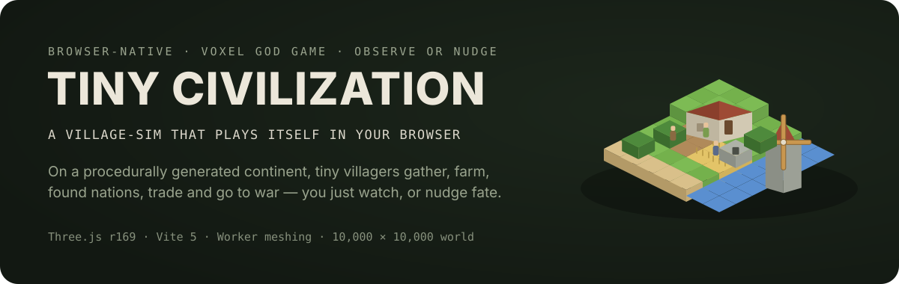

<div align="center">

[中文](./README.md) | **English**



[](https://github.com/LINYEANSHU/tiny-civilization/actions/workflows/ci.yml)
[](./LICENSE)


**A voxel civilization that runs itself in your browser.**

On a 10,000 × 10,000 procedurally generated continent, tiny villagers gather, farm,
found settlements and build nations. Seasons turn, caravans travel, wars and plagues
come and go — history writes itself while you watch, or nudge fate with the hand of god.

</div>

---

## ✨ Features

- **A real voxel world** — fBm continents, ridge-noise mountains, domain-warped rivers, and nine biomes from ocean to snowfield. Terrain is a pure function: any coordinate evaluates independently, and the same seed always reproduces the same world.
- **Self-governing settlements** — sites are scored and founded automatically; each settlement plans its house plots, farms, woodland and quarry, then expands on its own priorities: food security → housing → storage → market → town hall → walls. Four building cultures (timber, masonry, adobe, nordic) follow the biome.
- **Living inhabitants** — blocky villagers (part-level InstancedMesh batching) driven by a finite-state machine: farmers tend and harvest real growing crops, lumberjacks fell and replant trees, builders raise houses one by one, fishers work the docks. They go home at night and shut their doors in blizzards.
- **Layered simulation** — full villager-level simulation near the camera, abstract settlement-level simulation far away, one shared state: leave and return, and nothing respawns out of thin air.
- **Environment** — day/night with starfields, seasons with snowfall, 400-tile weather cells that let regions have different weather at once. Droughts crack fields, floods swallow fields and then recede, wildfires spread, plagues and blizzards bite — all by editing real voxels.
- **Nations & war** — settlements aggregate into nations by geography; four tech eras (Stone → Agrarian → Metal → Gunpowder) raise productivity and armies. Caravans trade along complementary needs; broken diplomacy leads to war — musters, marches, sieges, walls, conquest and truce, with soldiers clashing up close.
- **Chronicle & panorama** — foundings, buildings, growth milestones, disasters, trades, wars and conquests all flow into a filterable world chronicle; a full-screen map shows territories, trade routes and front lines, and clicking anywhere travels there.
- **Save slots** — IndexedDB autosave plus 3 manual slots, with `.json` export / import for sharing worlds across browsers; reloading a page resumes the same day.
- **中 / EN bilingual** — one click to switch (🌐 button, top right); defaults to your browser language and remembers your choice.

## 🚀 Quick start

```bash
git clone https://github.com/LINYEANSHU/tiny-civilization.git
cd tiny-civilization
npm install
npm run dev        # → http://127.0.0.1:8138
```

Production build: `npm run build && npm run preview`.

Append `?seed=any-string` to the URL to pick a world seed — the same seed always generates the same initial world.

## 🎮 How to play: watch, don't play

Tiny Civilization is an observation sandbox. There is no winning, no quests —
the pleasure is watching a world organize itself. Your interventions (the Hand of
God) only give the rolling snowball a gentle push.

| Action | How |
| --- | --- |
| Pan / orbit / zoom | Left-drag / middle-drag / scroll (or WASD) |
| Select | Click a villager for their panel; click a building or the ground for its settlement |
| Time | Space to pause; 1× – 256× speed; +1y / +10y / +100y real-evolution jumps |
| Sun lock | ☀ in the bottom bar (on by default): the sun holds still while fast-forwarding |
| World panorama | `M` — territories, trade routes, war front lines; click to travel |
| Chronicle | 📜 in the bottom bar; filter by war, building, trade, boons & banes |
| Hand of God | Left panel: weather, disasters, found a settlement, plant a forest, grant food, fair weather |
| Saves | 💾 in the bottom bar: autosave + 3 manual slots + export / import |

> Tip: press **+100y** and do nothing — watch villages grow into cities and borders get rewritten.

## 🏗️ Architecture

```
src/
├── core/          rng / noise / config          pure functions, reproducible
├── world/
│   ├── terrain.js       pure-function terrain (infinite world, on-demand evaluation)
│   ├── claims.js        settlement territory registry (no trees inside villages)
│   ├── buildings.js     voxel building stamps (four cultures)
│   ├── mesher.js        face culling + AO + material passes (pure data, Worker-safe)
│   ├── workers/         gen worker: terrain / vegetation / edits / meshing / queries
│   └── chunkManager.js  view loading/unloading / edit journal (persisted replay) / height cache
├── sim/           clock / naming / settlement economy / villager FSM / weather /
│                  disasters / nations, war & trade / orchestrator
├── render/        scene (day-night & seasonal shading) / InstancedMesh characters /
│                  particles / minimap & panorama
├── i18n.js        zh / EN dictionaries (events store keys, translated at render time)
├── save.js        IndexedDB saves (seed + clock + settlements + nations + journal + history + camera)
└── main.js        HUD / selection / god tools / save manager / language switch
```

**Worker & main thread**: terrain sampling, vegetation scattering, meshing and tree
queries all run in a single generation worker; the main thread only uploads
BufferGeometry and renders. Edit requests and generation requests get separate
quotas, and consecutive edits coalesce into one re-mesh. The simulation clock
advances on real time (frame-rate independent, with a per-frame cap against catch-up
spirals), so 256× speed and 100-year jumps never freeze the page.

## 📊 Verified

- Identical seeds reproduce the initial world exactly; chunks load / unload correctly across long round trips
- A 7,942 in-game-year soak test (219 disasters + 280 war events) with zero JS exceptions; simulation p50 ≈ 0.1 ms per frame
- 25s at 256× shows settlements growing on their own: population 6 → 34, houses 2 → 7; long runs reach 12 towns and 13 walled settlements
- Save → reload → restore: evolution continues from the same day with buildings, edit journal and chronicle intact

## 🙏 References & acknowledgements

- This project grew out of the author's previous **WorldForge (3D world generator)** and reuses its terrain / meshing / texture system
- World management borrows from [Minecraft](https://www.minecraft.net/)'s chunked voxel approach — chunked loading, on-demand generation, edit journals
- [Three.js](https://threejs.org/) — WebGL rendering
- [Vite](https://vite.dev/) — dev server & build
- Thanks to the observation sandboxes and voxel games that inspired this

## 📄 License

[MIT](./LICENSE) © 2026 LINYEANSHU

---

<div align="center">

[中文](./README.md) | [English](./README.en.md) · [⬆ Back to top](#-features)

</div>
