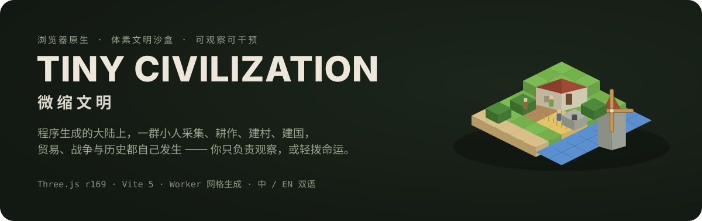
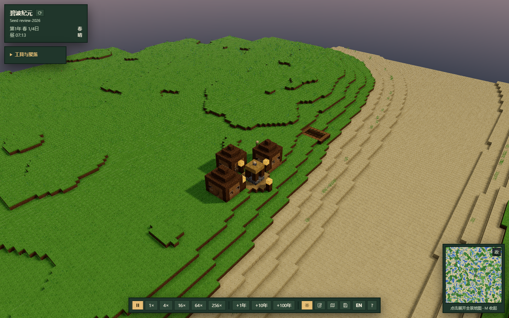
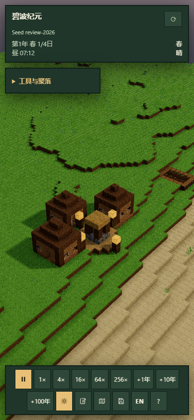

# Tiny Civilization · 微缩文明

**简体中文** · [English](README.en.md) · [CI](https://github.com/LINYEANSHU/tiny-civilization/actions/workflows/ci.yml)



**给世界一个种子，看村庄自己长成历史。**
在程序生成的体素大陆上，村民采集、种田、建屋，聚落发展为国家，贸易与战争写进编年史。
你可以安静观察，也可以改变天气、播种森林或创建聚落。



<details>
<summary>查看窄屏界面（390 × 844）</summary>



</details>

截图来自 2026-11-06 的桌面 Chromium 审查，使用 SwiftShader 在 CPU 上执行 WebGL；未测试真实手机硬件。

## 世界如何自己发展

- **地形有种子**：10,000 × 10,000 方块的逻辑世界按区块生成；相同种子复现初始地形。
- **聚落有需求**：居民采集与耕作，聚落按粮食、住房、仓储等需求自主扩建。
- **距离改变模拟粒度**：附近运行村民行为，远方按聚落推演，资源与人口沿用同一份状态。
- **环境会留下影响**：四季、天气、洪水、野火和疫病参与世界演化。
- **历史可以追踪**：国家、商路、战争和征服出现在全景地图与可筛选编年史中。

没有胜负或任务。时间控制与「上帝之手」让你比较长期演变，也能随时回到普通速度继续观察。

## 快速开始

需要 Node.js 22+、npm 和支持 WebGL 2 的现代桌面浏览器。

```bash
git clone https://github.com/LINYEANSHU/tiny-civilization.git
cd tiny-civilization
npm ci
npm run dev
```

打开 `http://127.0.0.1:8138`，等待世界生成后即可观察初始聚落。
用「工具与聚落」选择聚落，或打开地图跳转到其他位置。

```text
http://127.0.0.1:8138/?seed=my-world
```

URL 的 `seed` 指定初始世界；自动生成的种子也会写回 URL，刷新时用于匹配自动存档。

```bash
npm run build       # 输出 dist/
npm run preview     # 预览生产构建
```

Windows PowerShell 如拦截 npm 脚本，可使用 `npm.cmd` 执行相同命令。

## 观察与干预

| 操作 | 方式 |
| --- | --- |
| 平移 / 旋转 / 缩放 | 左键拖动或 WASD / 中键拖动 / 滚轮 |
| 查看居民或聚落 | 点击村民、建筑或地面 |
| 暂停 / 变速 | `Space` / 底部 1×–256× 按钮 |
| 长期演变 | +1 年、+10 年、+100 年按钮 |
| 全景地图 / 关闭面板 | `M` / `Escape` |
| 编年史 / 存档 | 底部对应按钮 |
| 改天气、降灾害、赐食物 | 「工具与聚落」中的上帝工具 |
| 性能详情 | `F3` |

高速演化时可使用底部日照锁定，减少昼夜切换造成的闪烁。语言按钮切换中文/英文。

## 保存、导出与恢复

IndexedDB 每 3 分钟自动存档，并提供 3 个手动槽位。
底部存档面板可保存、读取、删除槽位，以及导出/导入 JSON。
存档包含种子、时钟、聚落、国家、体素编辑日志、历史和镜头状态。

读取槽位会按其种子重新加载页面；刷新时只恢复与 URL 种子匹配的自动存档。
同一种子决定初始世界，已演化的世界还需要存档。清理网站数据前请导出备份。

## 验证与边界

2026-11-06 重新执行：

```bash
node _verify_optim.mjs check
npm run build
```

- 全部 `src/**/*.js` 通过 `node --check`；生产构建通过。
- 现有 CPU 行为校验与基线 **`92fb878f`** 一致，覆盖地形、噪声、领地、方块和网格裁剪等价性。
- 同日浏览器审查覆盖桌面/窄屏布局、聚落选择、编年史、手动槽位、地图、语言切换及种子刷新恢复。
- 游戏使用 Three.js / WebGL 2；审查采用 SwiftShader CPU 渲染，普通启动不会强制 CPU 渲染。
- 仓库没有 npm 单元测试套件；未验证长期人口/战争平衡、其他浏览器引擎或真实触屏，嵌套存档字段也尚非完整安全校验。

## 开发入口

`src/world/` 管地形、区块与 Worker 网格，`src/sim/` 管居民、聚落、国家和时间，`src/save.js` 管持久化。
设计取舍见 [DESIGN.md](DESIGN.md)。

## 贡献者

[LINYEANSHU](https://github.com/LINYEANSHU)

## 许可与来源

[MIT](LICENSE) © 2026 LINYEANSHU。运行时使用 [Three.js](https://threejs.org/)，开发构建使用 [Vite](https://vite.dev/)。
地形、网格与贴图体系延续作者的 WorldForge；分块体素世界管理受到 [Minecraft](https://www.minecraft.net/) 启发。
