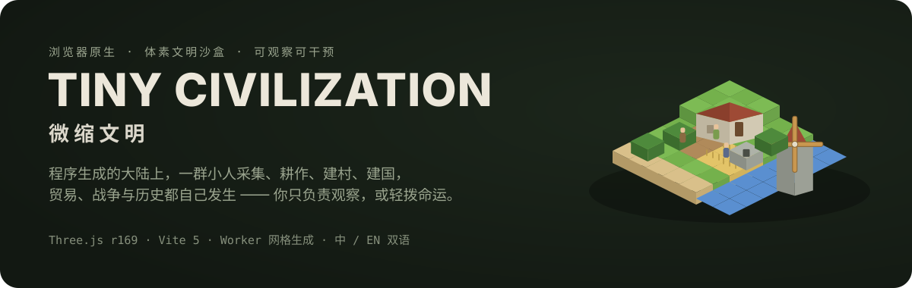
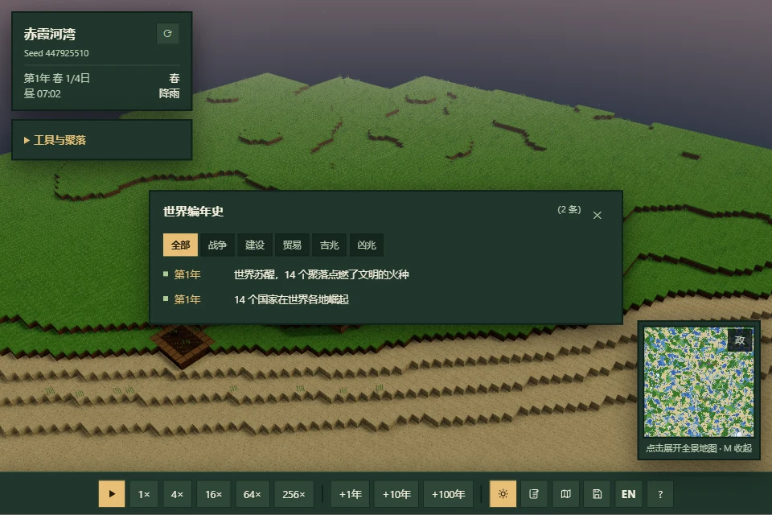
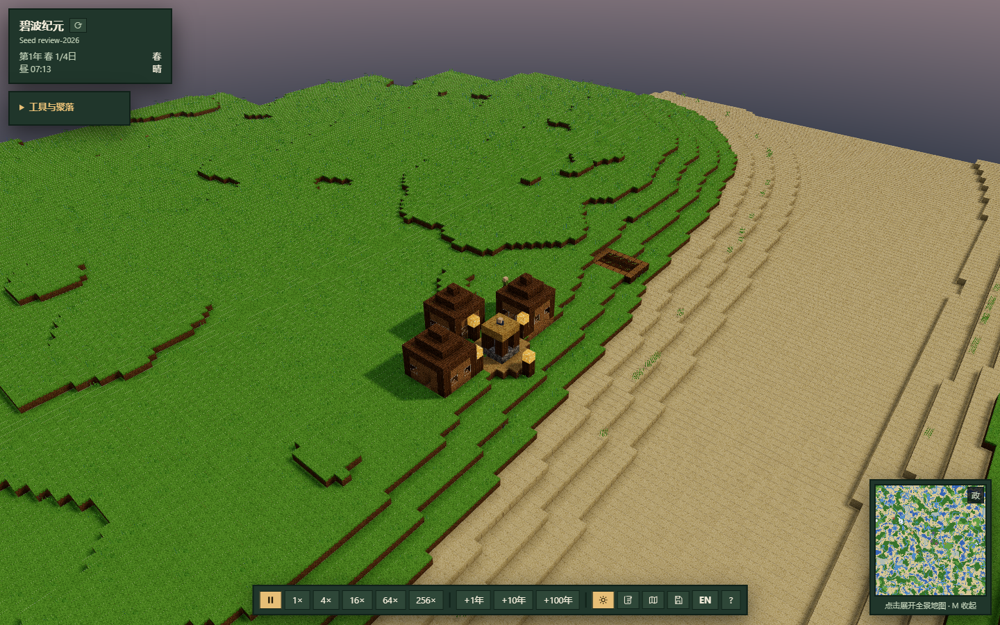
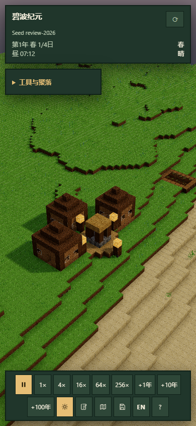

# Tiny Civilization · 微缩文明

**简体中文** · [English](README.en.md) · [CI](https://github.com/LINYEANSHU/tiny-civilization/actions/workflows/ci.yml)



**给世界一个种子，看村庄自己长成历史。**
在程序生成的体素大陆上，村民采集、种田、建屋，聚落发展为国家，贸易与战争写进编年史。
你可以安静观察，也可以改变天气、播种森林或创建聚落。

## Windows 下载

**[下载 Windows x64 便携版（ZIP）](https://github.com/LINYEANSHU/tiny-civilization/releases/download/windows-v1.0.0/tiny-civilization-windows-x64.zip)** · [发布说明](https://github.com/LINYEANSHU/tiny-civilization/releases/tag/windows-v1.0.0)

完整解压 ZIP，进入 `Tiny Civilization` 文件夹并双击 `Tiny Civilization.exe`。世界生成后就能观察初始聚落。移动游戏时请保留整个文件夹。
该下载为 Windows v1.0.0。星际模式可从当前源码运行。



<details>
<summary>查看浏览器界面（桌面与窄屏）</summary>





截图来自 2026-11-06 的桌面 Chromium 审查，使用 SwiftShader 在 CPU 上执行 WebGL；未测试真实手机硬件。

</details>

## 世界如何自己发展

- **地形有种子**：10,000 × 10,000 方块的逻辑世界按区块生成；相同种子复现初始地形。
- **聚落有需求**：居民采集与耕作，聚落按粮食、住房、仓储等需求自主扩建。
- **距离改变模拟粒度**：附近运行村民行为，远方按聚落推演，资源与人口沿用同一份状态。
- **环境会留下影响**：四季、天气、洪水、野火和疫病参与世界演化。
- **历史可以追踪**：国家、商路、战争和征服出现在全景地图与可筛选编年史中。

没有胜负或任务。时间控制与「上帝之手」让你比较长期演变，也能随时回到普通速度继续观察。

## 星际时代

从世界信息栏打开「游戏模式」。**自由星际**直接进入星图并指挥一颗具备初代航天技术的母星。**文明升轨**先运行地面世界。度过两年、任一聚落曾达到 12 人，并建成至少一个采石场、市场或谷仓后，即可执行升轨。「将当前地面世界带入战役」会复制现有大陆进度，升轨时将其封存为可导出的地面存档。

- 每个种子生成 192 个恒星系。选取恒星查看其行星轨道、恒星预报和行星资源，从自己控制的星球派出勘察、殖民、贸易、议和或军事任务。
- 电力、矿产、科研与舰队在各行星结算。每颗有人居住的行星都有独立的当地文明身份。征服改变所属势力，竞争对手也会扩张和反击。重点行星逐年推演，远方文明按八年批次更新。
- 科研分为 4 个时代和 6 条行星适应路线，共 90 项。温带、海洋、冰封、干旱、火山与高辐射环境提供不同发展条件。
- 星际通信以光速传播，舰队以亚光速航行，星系内转移考虑轨道窗口。双体轨道、平均辐照和行星评分用于推演。部分临近寿命终点的恒星使用加速情景时间表，可经历膨胀和坍缩。

## 从源码运行浏览器版

需要 Node.js 22+、npm 和现代桌面浏览器。地面阶段需要 WebGL 2，自由星际可直接以 Canvas 2D 运行。

```bash
git clone https://github.com/LINYEANSHU/tiny-civilization.git
cd tiny-civilization
npm ci
npm run dev
```

打开 `http://127.0.0.1:8138`，等待世界生成后即可观察初始聚落。
用「工具与聚落」选择聚落，或打开地图跳转到其他位置。

```text
http://127.0.0.1:8138/?seed=my-world
```

URL 的 `seed` 指定初始世界；自动生成的种子也会写回 URL，刷新时用于匹配自动存档。
`?mode=space&seed=my-world` 直接打开自由星际，`?mode=campaign` 进入或继续文明升轨。

```bash
npm run build       # 输出 dist/
npm run preview     # 预览生产构建
```

Windows PowerShell 如拦截 npm 脚本，可使用 `npm.cmd` 执行相同命令。

## 观察与干预

| 操作 | 方式 |
| --- | --- |
| 平移 / 旋转 / 缩放 | 左键拖动或 WASD / 中键拖动 / 滚轮 |
| 查看居民或聚落 | 点击村民、建筑或地面 |
| 暂停 / 变速 | `Space` / 底部 1×–256× 按钮 |
| 长期演变 | +1 年、+10 年、+100 年按钮 |
| 全景地图 / 关闭面板 | `M` / `Escape` |
| 编年史 / 存档 | 底部对应按钮 |
| 改天气、降灾害、赐食物 | 「工具与聚落」中的上帝工具 |
| 安排谷仓或市场优先施工 | 点选聚落 →「民生工程」，按标价使用聚落自己的材料 |
| 性能详情 | `F3` |

高速演化时可使用底部日照锁定，减少昼夜切换造成的闪烁。语言按钮切换中文/英文。

## 保存、导出与恢复

IndexedDB 每 3 分钟或页面隐藏时自动存档，并提供 3 个手动槽位。
底部存档面板可保存、读取、删除槽位，以及导出/导入 JSON。
存档包含种子、时钟（含暂停和倍速）、聚落及施工队列、国家、体素编辑日志、历史和镜头状态。
三个游戏模式各有独立自动存档和手动槽位。星际进度同时记录科研、行星文明和在途任务，并在执行命令和推进时间后自动保存。原地面 v2/v3 存档仍可读取和导入。

直接打开游戏会继续自动存档。指定 URL 种子时，游戏会恢复同种子存档，并在浏览其他种子时保留原自动存档。从存档管理读取手动槽位后，可继续从该世界自动保存。
同一种子决定初始世界，已演化的世界还需要存档。Windows 桌面版默认在 `%APPDATA%\Entertainment Desktop\tiny-civilization` 保存数据。

## 验证与边界

2026-11-06 重新执行：

```bash
node _verify_optim.mjs check
npm run build
```

- 全部 `src/**/*.js` 通过 `node --check`；生产构建通过。
- 现有 CPU 行为校验与基线 **`92fb878f`** 一致，覆盖地形、噪声、领地、方块和网格裁剪等价性。
- 同日浏览器审查覆盖桌面/窄屏布局、聚落选择、编年史、手动槽位、地图、语言切换及种子刷新恢复。
- 游戏使用 Three.js / WebGL 2。Windows 桌面版通过 SwiftShader 在 CPU 上渲染；浏览器版遵循浏览器的渲染设置。
- 使用 `node --test test/world-progress.test.js` 验证时钟、民生工程与存档兼容性。
- 使用 `node --test test/interstellar.test.js` 验证星图生成、恒星演化、光速延迟、殖民与征服、科研依赖和升轨兼容性。

## 开发入口

在 Windows x64 上使用 Node.js 24 运行 `node desktop/build.cjs`，桌面包生成到 `desktop/dist/`。[桌面构建脚本](desktop/build.cjs)

`src/world/` 管地形、区块与 Worker 网格，`src/sim/` 管地面居民、聚落、国家和时间，`src/space/` 管星图、星际模拟和界面，`src/save.js` 管持久化。
设计取舍见 [DESIGN.md](DESIGN.md)。

## 贡献者

[LINYEANSHU](https://github.com/LINYEANSHU)

## 许可与来源

[MIT](LICENSE) © 2026 LINYEANSHU。运行时使用 [Three.js](https://threejs.org/)，开发构建使用 [Vite](https://vite.dev/)。
地形、网格与贴图体系延续作者的 WorldForge；分块体素世界管理受到 [Minecraft](https://www.minecraft.net/) 启发。
